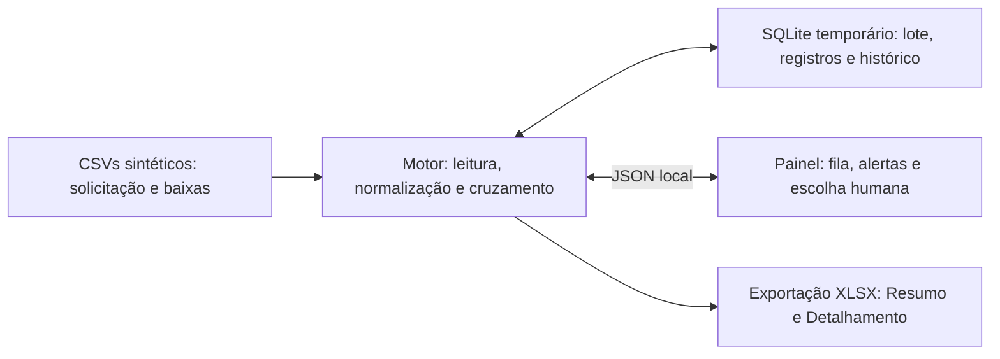

# Audit Fluxo — conferência de baixas para auditoria

Uma demonstração de portfólio que transforma um pedido de auditoria e uma base de baixas em uma fila revisável. Marca, empresas, contas, códigos, datas e valores da amostra foram inventados; não há identificadores fiscais nem comprovantes no pacote.

## Problema e proposta

Quando a auditoria pede a documentação de uma nota, a equipe precisa descobrir quais lançamentos da base correspondem àquela nota. Um mesmo código pode aparecer em filiais diferentes; uma nota pode ter mais de uma baixa; e um lançamento em conta transitória não identifica, por si só, o banco utilizado.

O painel localiza candidatos por critérios explícitos, explica as exceções e registra a seleção humana. O Excel resultante é um mapa para a etapa seguinte. **Baixa localizada, vínculo conferido e comprovante bancário são três coisas distintas.** A demo não confirma pagamento, busca comprovantes nem envia um atendimento à auditoria.

## Como abrir

1. Extraia o ZIP. Abra um terminal dentro da pasta `audit-fluxo-demo`.
2. Com **Python 3.9 ou superior**, rode `python3 app/demo.py` (no Windows, use `py app/demo.py`).
3. Abra no navegador o endereço mostrado no terminal e clique em **Carregar dados de exemplo**. Não é preciso instalar bibliotecas ou acessar a internet.
4. A tela abre na nota fictícia **NF-DEMO-02**. Selecione as duas baixas, preencha uma justificativa de ensaio e clique em **Confirmar vínculo**. Use **Exportar Excel** para baixar o retrato do lote.
5. Para encerrar, pressione **Ctrl+C** no terminal. Para repetir a gravação do zero, encerre e execute novamente. **Recarregar exemplo** na mesma sessão preserva as decisões sobre o mesmo lote.

O servidor aceita somente conexões de loopback. Se a porta padrão estiver em uso, acrescente `--port 8766` ao comando. O banco e o arquivo usado pelo servidor para gerar a saída ficam em armazenamento temporário; a planilha baixada permanece na pasta de downloads. Não há importação de arquivos pelo painel de portfólio.

## Regras de negócio

| Regra | Efeito na conferência |
| --- | --- |
| Identificação | Cruze código do documento e filial. Sem filial, mostre as possibilidades, mas exija aplicar uma filial antes de selecionar vínculos. Sem código, não invente candidatos. Código do título não substitui código do documento. |
| Tipo de documento | O exemplo usa o tipo **2** para as baixas elegíveis. Registros de outros tipos aparecem como candidatos explicados, mas não são selecionáveis. |
| Valores | Calcule em centavos. O líquido localizado soma registros elegíveis; o selecionado soma apenas os marcados. A tolerância da amostra é zero. Compare o líquido informado com principal + juros − descontos + multa quando todos existirem. |
| Exceções | Filial ausente, múltiplas baixas, contas contábeis, permuta, divergências e outros sinais ficam visíveis. O painel preserva a descrição original da conta; não deduz banco nem quantidade de pagamentos. |
| Decisão | Para confirmar, é necessário ter filial e selecionar ao menos uma baixa elegível. Exceções ou diferença do valor selecionado exigem justificativa. A decisão fica no histórico da sessão. |
| Atualização da base | No motor, uma nova base substitui a anterior; não acumula registros. Se a mudança afetar os candidatos já revisados, o motor invalida a conferência para revisão. Na demo não há botão de troca de base: essa regra é exercitada nos testes. |
| Exportação | **Resumo**: uma linha por documento, com status, totais e alertas. **Detalhamento**: uma linha por candidato do documento, com conta, composição, origem e marcação da escolha. A saída guarda valores, não fórmulas nem conexões. |

A amostra tem seis documentos e sete registros de baixa. Dois documentos começam com uma baixa encontrada sem alerta, dois requerem conferência e dois não têm correspondência elegível (um deles tem candidato de outro tipo).

## Arquitetura



| Caminho | Responsabilidade |
| --- | --- |
| `exemplos/` | Entradas sintéticas usadas pelo botão de exemplo e pelos testes. |
| `app/engine.py` e `app/xlsx_reader.py` | Leitura de CSV/XLSX, normalização, cruzamento em centavos, regras de elegibilidade e conferência. O painel usa apenas os CSVs incluídos. |
| `app/demo.py` | Servidor local sem dependências, adaptação da amostra ao motor e entrega do Excel. |
| `app/xlsx_writer.py` | Montagem do Excel com resumo e trilha detalhada. |
| `static/` | Uma tela em HTML, CSS e JavaScript, sem bibliotecas externas. |
| `testes/` | Cenários sintéticos de vínculo, exceção, exportação e troca de base. |

## Testar

```sh
python3 -m unittest discover -s testes -v
```

No Windows, substitua `python3` por `py`.

## Roteiro de 45 segundos

1. Carregue o lote. Mostre os seis documentos e a exceção aberta.
2. Aponte as duas baixas da nota, incluindo a conta transitória. Selecione ambas e mostre a mudança no **Líquido selecionado**.
3. Digite, por exemplo, “Na amostra, revisei os dois lançamentos que compõem esta nota.” Confirme e mostre a mudança em **Vínculos conferidos**.
4. Exporte o Excel e encerre com a ressalva: “Conferi o vínculo, não o comprovante bancário.”
